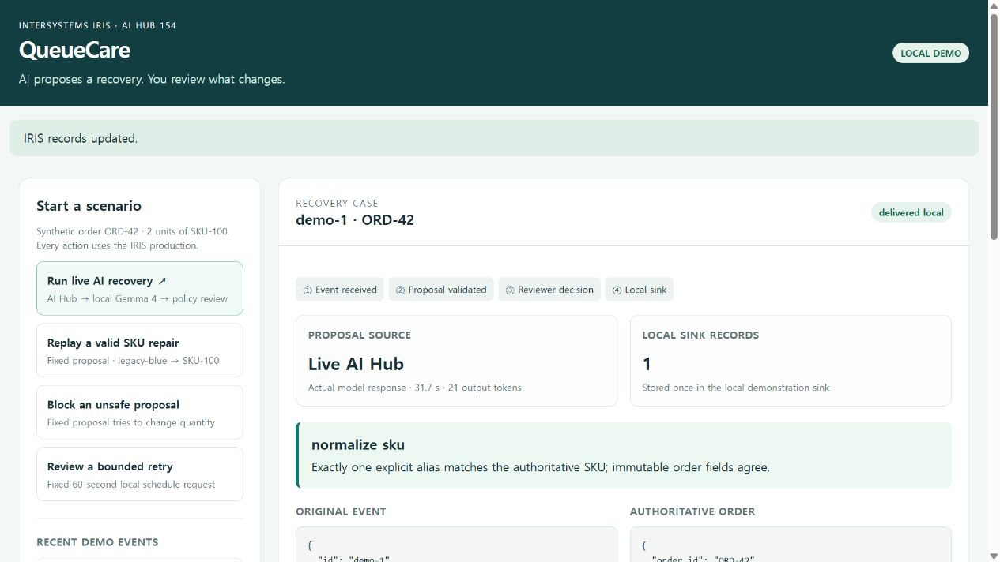

# QueueCare

**A reviewable recovery workflow for failed order-integration events.**

A warehouse sends `legacy-blue`, while the authoritative order expects
`SKU-100`. QueueCare asks an IRIS AI Hub agent for a recovery proposal,
validates it against trusted order and alias records, and waits for approval.
Approving it writes the corrected event to a local demonstration sink once.
Changing a quantity, inventing an alias, or replaying an event ID with different
content cannot silently change an order.

This application is being prepared for the **2026 InterSystems AI Agents in
Interoperability Workflows** contest. It is not yet submitted. All example
orders are synthetic. No real orders, customers, or shipments are processed.



## What has been run

- Python policy: 11 tests, including 34 hand-authored adversarial cases, passed.
- Real IRIS **2026.3.0AI build 154**: 16 integration assertions passed through
  `Ens.BusinessService → Ens.BusinessProcess → Ens.BusinessOperation`.
- Actual `%AI.Agent.Chat` to local Ollama `gemma4:e4b` through that production:
  a live SKU recovery completed, passed policy, and waited for approval.
- Local browser console: live inference, approval, duplicate submission,
  unsafe replay, bounded schedule and denial were exercised through the UI.
  Ten follow-up HTTP/data assertions passed, including origin/token checks.
- Separate direct Ollama smoke evaluation: 10/10 expected dispositions on a
  small author-written development set. This is **not a held-out benchmark**
  or a contest score.

Evidence is in `reports/iris-integration.json`, `reports/iris-live.json`,
`reports/console-smoke.json`, and `reports/local-evaluation.json`.
The IRIS report labels replay explicitly;
the live report includes the actual AI Hub token and timing statistics.
`approved` inside a policy decision means **policy validation passed**. Only
an event state transition after `API.Approve` records reviewer approval.

## Workflow

1. The public application API accepts an event, not authoritative order data.
2. The IRIS production loads the order and alias configuration from its database.
3. In `live` mode, `%AI.Agent.Chat` produces a JSON suggestion. A provider failure
   is held for review; it never silently switches to a canned response.
4. Embedded Python rejects duplicate JSON keys, nonfinite numbers, extra fields,
   malformed responses, invented aliases, identity/quantity changes, and
   unbounded retries.
5. IRIS stores immutable input/proposal/decision snapshots and journal events.
6. Approval rechecks current authoritative records. Changes since the proposal
   cause `held_stale_context` and no sink write.
7. A unique `(source, event_id)` digest plus an IRIS lock and transaction prevents
   duplicate local application. A different payload under the same identity
   is rejected as a conflict.

`normalize_sku` writes only to the **local demonstration sink**. `retry_later`
creates a local schedule record; this version has no retry dispatcher and does
not claim delivery. A reviewer may deny a proposal. Held events require manual
investigation; automatic re-opening is not implemented.

## Prerequisites

- Docker Engine and Docker Compose v2.
- The official **x64 Community AI Hub build 154** image, downloaded by you from
  [the InterSystems EAP portal](https://evaluation.intersystems.com/Eval/early-access/AIHub).
- A local Ollama installation with a compatible model already downloaded. Our
  reference run used `gemma4:e4b`; model weights are not bundled.
- Enough memory for the selected model plus IRIS. This project limits the IRIS
  database cache to 512 MB and routine cache to 80 MB. CPU inference works;
  a GPU is not required for the provided smoke example.

The EAP image and images derived from it must **not be pushed to a public
registry**. The contest announcement explicitly permits development and demos
for the contest; other EAP restrictions remain relevant. Judges download and
load the image themselves. No paid model API or API key is required by the
reference configuration.

## Start

Load the official download and retag the image name printed by Docker:

```sh
docker image load -i /path/to/iris-community-2026.3.0AI.154.0-docker.tar.gz
docker tag docker.iscinternal.com/docker-intersystems/intersystems/iris-community:2026.3.0AI.154.0 iris-community:2026.3.0AI.154.0
cp .env.example .env
```

Set `OLLAMA_MODELS_DIR` in `.env` to the absolute path of your existing
`.ollama/models` directory. On WSL, use its Linux-visible path. The reference
Compose configuration mounts the original models read-only, copies only model
manifests into a separate volume, and disables cloud calls and pruning.

```sh
docker compose build iris
docker compose --profile local-model up
```

Keep that command running; in WSL this also keeps the distribution active.
In a second terminal, wait for IRIS and run the deterministic integration demo:

```sh
docker compose up -d --wait --wait-timeout 60 iris
docker compose exec -T iris iris session IRIS < tools/test-iris.script
```

Run the real AI Hub call:

```sh
docker compose exec -T iris iris session IRIS < tools/test-live.script
```

The first model load is slower than subsequent requests. Inspect the JSON
report's `passed`, `agent_call_completed`, `state`, and `decision` fields.
There is no success fallback when inference fails. No host ports are published.
The application source and reports are inspectable without a video.

## Review in your browser

With the containers running, start the optional console from a host terminal
in this repository. It uses Python 3's standard library and your existing
Docker access; no additional Python packages or IRIS host ports are needed.

```sh
python tools/serve_demo.py
# Windows host with Docker inside WSL:
python tools/serve_demo.py --wsl-distro Ubuntu-24.04
```

Open `http://127.0.0.1:8075`. The server binds only to local loopback and is a
single-user demonstration, not an authenticated shared deployment. Stop it
with Ctrl+C. The console reads and changes only its synthetic `web-demo`
events; every scenario still passes through the IRIS production.

1. Select **Run live AI recovery**. Wait for the actual AI Hub response.
2. Compare the original SKU, authoritative order and raw model proposal.
3. Check that the state is `awaiting_approval` and the local sink count is 0.
4. Select **Approve local action**. The sink contains exactly one corrected
   event, with the original order ID and quantity unchanged.
5. Select **Resend same event**. The existing result is returned and the sink
   count remains 1; no second inference is run.
6. Select **Block an unsafe proposal** to inspect a clearly labeled replay
   that tries to modify quantity. It is held, with approval disabled.
7. The retry replay demonstrates a schedule record, not a running dispatcher.

The console exposes fixed synthetic scenarios instead of an arbitrary code or
SQL execution interface. It displays raw proposals as text and distinguishes
live failures from replay. It does not change your trusted order configuration.

For an already running model endpoint, omit the `local-model` profile and set
`QUEUECARE_LLM_BASE_URL` to its OpenAI-compatible URL reachable **from inside
the container**, ending in `/v1/`. Do not expose an unauthenticated model
server publicly. The supplied agent uses Ollama's placeholder key `ollama`;
it is not configured for a paid provider.

## Inspect and approve a live example

Open an IRIS terminal:

```sh
docker compose exec iris iris session IRIS -U QUEUECARE
```

Use the source and event ID printed by the live report:

```objectscript
write ##class(QueueCare.Store).Status("live-integration-test","live-alias-1"),!
write ##class(QueueCare.API).Approve("live-integration-test","live-alias-1",1,"demo-reviewer"),!
```

Use `0` instead of `1` to deny a pending proposal. Approval targets only the
local sink. A repeated approval is idempotent. `QueueCare.Data.Event`,
`QueueCare.Data.Journal`, and `QueueCare.Data.Delivery` are persistent IRIS
tables. They survive a container restart; **recreating the container currently
resets the demo database**. Copy out needed evidence before a rebuild.

## Policy tests without IRIS

```sh
python -m unittest discover -s tests -p test_core.py -v
python tools/evaluate_local.py --model gemma4:e4b
```

The latter talks to a locally running Ollama on `127.0.0.1:11434` and is a
separate development evaluation. It does not replace the AI Hub integration
test. `fixtures/cases.jsonl` contains deliberate synthetic responses, not
claimed model outputs.

## Scope and current limitations

This is a local demonstration application, not a production shipping system.
There is no external delivery adapter, retry worker, multi-user approval UI,
or production authentication configuration. CLI users already control the
container. Journal records are append-only through the application API, not
tamper-proof against database administrators. Inference is serialized by one
queued operation worker, and an interrupted in-flight event may remain held
or analyzing for manual investigation. The small development tests do not
establish broad model reliability or a chance of winning the competition.

## Sources and attribution

The original QueueCare workflow and policy were developed with AI coding
assistance. No employment history or customer results are claimed.

- [Contest requirements and AI assistance clarification](https://community.intersystems.com/post/intersystems-programming-contest-ai-agents-interoperability-workflows)
- [AI Hub ObjectScript SDK](https://github.com/intersystems-community/ai-hub-eap)
- [Community development template](https://github.com/intersystems-community/ai-hub-dev-template), MIT; provider initialization and container setup informed this app.
- [IRIS interoperability examples](https://github.com/intersystems-community/iris-ai-examples), used to verify the service/process/operation API pattern.

Only application source is licensed under the included MIT license.
